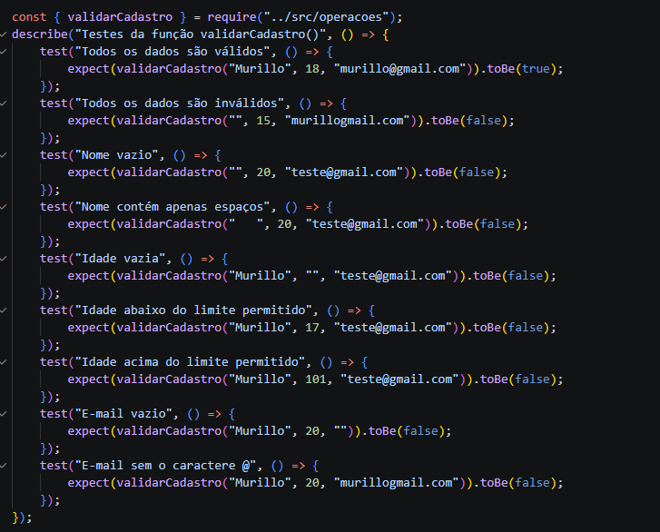
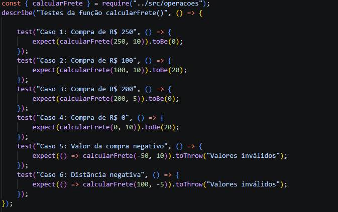
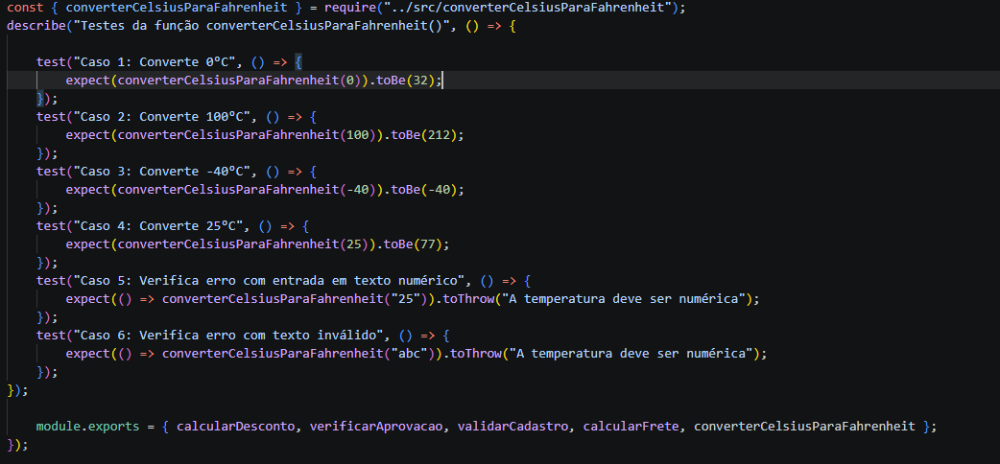

# Nome: Murillo de Oliveira Ribeiro

# Questão 1

## A
a função calcularDesconto recebe dois valores: o preço de um produto (valor) e a porcentagem de desconto (percentual). primeiro, ela verifica se os dados são válidos. se o valor for menor ou igual a zero, ou se o percentual for menor que 0 ou maior que 100, ela apresenta um erro com a mensagem Dados inválidos. Se os dados estiverem corretos, a função calcula o desconto e subtrai esse valor do preço original, retornando o preço final do produto com o desconto aplicado.

## B
Desconto de 10% - valor = 100, percentual = 10: ; Retorna 90:
Desconto de 50% - valor = 100, percentual = 50 : ; Retorna 50:
Dados Inválidos - valor = 100, percentual = 120: ; Retorna Dados Inválidos:

## C

# Questão 2

## A

A função verificarAprovacao recebe uma nota como entrada e verifica se ela está dentro do intervalo permitido, de 0 a 10.Se a nota for menor que 0 ou maior que 10, a função apresenta um erro com a mensagem "Nota inválida". Se a nota for maior ou igual a 7, retorna "Aprovado". Caso seja menor que 7, retorna "Reprovado".

## B
Nota de Aprovação - nota = 8; Retorna "Aprovado":
Nota de Reprovação - nota = 5 ; Retorna "Reprovado":
Nota Miníma - nota = 0; Retorna "Reprovado":
Nota Inválida - nota = 11; Retorna "Nota Inválida":

## C

## D 

Porque a função possui diversas situações. É necessário testar notas de aprovação, reprovação e valores inválidos para conseguir ver se todas irão funcionar corretamente. Assim, conseguimos identificar erros que um único teste não mostraria.

# Questão 3

## A 

A função precisa ter os valores nome, idade e e-mail preenchidos corretamente. O nome não pode estar vazio e nem conter apenas espaços, a idade precisa ser igual ou maior que 18 e menor ou igual a 100, e o email não pode estar vazio e precisa conter o caractere @. se as conndições forem atendidas a função retorna true, caso não sejem atendidadas a função retorna false.

## B

## C
O resultado será false, pois a função verifica cada informação separadamente. Mesmo que dois dados estejam corretos, se apenas um deles for inválido, o cadastro não será aceito.

# Questão 4

## A

## B 
Porque a função determina que compras com valor maiour ou igual a R$ 200 recebem frete grátis. Como a compra foi igual R$ 200, o frete deve ser zero, independente da distância

# Questão 5

## A

## B 
 Porque a entrada "25" está entre aspas, ou seja, o tipo da entrada está string. E a função exige que a temperatura seje um número, mesmo representando númericamente o 25, ela dá erro.

# Questão 6

## A
Testes unitários são testes feitos para verificar se pequenas partes de um código, como funções, estão funcionando corretamente. Eles são importantes porque ajudam a encontrar erros, evitar problemas e garantir que o sistema apresente os resultados esperados.

## B

Teste A – PASSA
A função recebe quantidade 3 e preço 10. O resultado é 3 × 10 = 30, exatamente como esperado
Teste B – PASSA
A quantidade é zero. Como zero multiplicado por 10 é zero, o resultado está correto
Teste C – PASSA
A quantidade é negativa (-2). A função identifica o valor inválido e lança o erro "Valores inválidos", como esperado
Teste D – FALHA
O preço unitário é negativo (-5). A função identifica esse valor como inválido e lança um erro, em vez de retornar -10

## C

O Teste D apresenta uma expectativa incompatível, pois a função não aceita valores negativos para quantidade ou preço unitário. por isso, o teste espera um resultado (-10), mas a função lança um erro com a mensagem "Valores inválidos"

# Questão 7

## A

Teste A – PASSA
A senha possui exatamente 8 caracteres. Como a função aceita senhas com 8 ou mais caracteres, o resultado é true.
Teste B – PASSA
A senha possui apenas 6 caracteres. Como tem menos de 8, a função retorna false, como esperado.
Teste C – FALHA
A senha possui 10 caracteres. Como a função aceita qualquer senha com 8 ou mais caracteres, o resultado deveria ser true, mas o teste espera false.
Teste D – PASSA
A senha possui 12 caracteres. Como está acima do mínimo de 8, a função retorna true, como esperado.

## B

O problema é que a expectativa está incorreta. A função não rejeita senhas com 10 caracteres, pois aceita qualquer senha que tenha pelo menos 8 caracteres. Portanto, o resultado esperado deveria ser true

## C

Não. A função verifica apenas a quantidade de caracteres da senha, por meio de senha.length. ela não verifica se existem letras maiúsculas, números ou caracteres especiais. por isso, qualquer senha com 8 ou mais caracteres será aceita, independentemente dos caracteres utilizados.